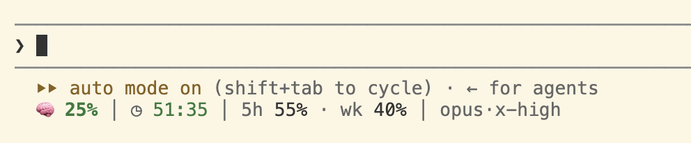

# Brain Drain for Claude Code

How full Claude's context is, when its cache goes cold, and how much of your 5-hour and weekly
limits is left — right under the prompt in Claude Code.



Brain Drain is a Claude Code mod: a plugin that runs inside Claude Code and reads its figures
from Claude Code itself. It never calls a model, makes no network requests, and never changes
what you type. Unless you turn on `/drain notify`, it adds nothing to what Claude reads. To check
this yourself before installing, clone the repository and run `claude plugin validate ./brain-drain`:
its `hooks:` and `calls:` lines list everything the mod asks Claude Code to do
([Mods overview](https://code.claude.com/docs/en/plugins/mods/overview)).

Not made by or affiliated with Anthropic.

## What it shows

- **Context:** how full the context window is, green, then yellow from 60%, red from 80%.
- **Cache countdown:** how long until the prompt cache expires, using the TTL Claude Code actually
  wrote (one hour or five minutes), read from the session transcript rather than guessed; if that
  cannot be read, the last lifetime seen on this account. Yellow under 60 seconds, red under 15,
  then `expired` (`exp` when the terminal is narrow).
- **Limits:** your 5-hour (`5h`) and weekly (`wk`) usage, yellow from 70%, red from 90%. Hidden
  when Claude Code reports none. The default style also shows when the 5-hour window resets, in
  your local time: `5h 55% ↻18:20`.
- **Model and effort**, for example `opus·medium`.

The context figure reads `–%` before the first reading, `~42%` after `/compact` until the next one,
and `⚠ 42%` when Claude Code reports a context window smaller than the tokens already in it.

Why the cache matters: Claude Code's documentation says that "after a long enough gap, the next
request recomputes the full input and re-establishes the cache, which is why the first turn back
after stepping away can be noticeably slower." It also says that once you go over your plan's
usage limit and draw on usage credits, "Claude Code drops the main conversation to the
five-minute TTL" ([How Claude Code uses prompt caching](https://code.claude.com/docs/en/prompt-caching)).
The countdown follows that switch.

## What it warns you about

- **A cold cache while you type.** If the cache has already expired, a red line appears under the
  gauge as soon as you start typing, before you send:
  `▲ cache expired · your next message re-writes ~312k tokens`
- **Expiry coming up.** A notice 60 seconds before the cache expires (`/drain warn` changes the
  lead time; `/drain sound on` adds a short chime).
- **What misses cost.** `/drain` lists the cache misses of today and the last 7 days, with the
  tokens re-written and the change in Claude Code's own session cost figure over the turn that
  opened cold. Misses are kept for 60 days.

## Telling Claude its own levels (off by default)

With `/drain notify on`, Brain Drain adds one line of facts to Claude's own context when a
threshold is crossed, so the session itself knows where it stands:

```
Brain Drain: context 71% (712k of 1M) · 5-hour window 82%, resets 18:20 · week 40% (pace line 48%)
```

- It speaks once per threshold, after a tool call or when you send a prompt, and again only after
  the figure has dropped back below it. It speaks to the main conversation only, never to
  subagents.
- Default thresholds: context 70% and 90%, 5-hour window 80% and 95%, and weekly use going above
  the pace line: the share of the week gone since your weekly reset, plus 5 points.
- The line states facts only. To tell Claude what to do about them, attach your own words to a
  threshold: `/drain notify text context 90 "wrap up and summarise"`.
- It works in non-interactive `claude -p` runs too, from the first tool call on. Nothing can
  arrive before Claude Code's first response, because the figures do not exist until then.

For unattended runs, the environment variable `BRAIN_DRAIN_NOTIFY` overrides your saved settings
for one run. It takes `on`, `off`, or JSON with any of these keys: `on`, `context` (a list),
`5h` (a list), `week` (true or false), `margin`, and `text` (keys `"context:35"`, `"5h:80"`,
`"week"`). Any JSON value turns the notice on for that run unless it includes `"on": false`.
For example:

```
BRAIN_DRAIN_NOTIFY='{"context":[30,35],"5h":[80],"text":{"context:35":"stop and write down your state"}}' claude -p "..."
```

## Install

Requires Claude Code v2.1.287 or later (the first version with mods). Tested with v2.1.300 on
macOS, and with v2.1.301 on Linux (Ubuntu 24.04, arm64, in a dev container). Windows untested.

```
claude plugin marketplace add makingaipractical/brain-drain-for-claude-code
claude plugin install brain-drain@brain-drain
```

On Claude Code v2.1.292 or later, one command does both:
`claude plugin install brain-drain --marketplace makingaipractical/brain-drain-for-claude-code`.

Then run `/reload-plugins` in an open session, or start a new one.

The gauge draws in `claude` in any terminal, including VS Code's integrated terminal. Mods also
run in the Code tab of the Claude Desktop app, but Brain Drain has not been tried there yet. It draws nothing in Anthropic's VS Code chat panel
([Mods overview](https://code.claude.com/docs/en/plugins/mods/overview), "Where mods run"), and the
[Brain Drain VS Code extension](https://marketplace.visualstudio.com/items?itemName=makingaipractical.claude-code-fuel-gauge)
cannot see chat-panel sessions either: the panel does not run Claude Code's status line (checked on
Claude Code 2.1.296).

To update: `claude plugin update brain-drain@brain-drain`, or turn on auto-update for the
marketplace in `/plugin` → Marketplaces.

**Nothing under the prompt?** Run `/plugin`: the line under the tabs should read
`1 mod active · brain-drain`. Check that `claude --version` is 2.1.287 or later. Mods are switched
off by `disableAllHooks` in your settings, by an organisation's `allowManagedModsOnly` or
`allowManagedHooksOnly` ([settings reference](https://code.claude.com/docs/en/settings-reference#what-runs-under-allowmanagedhooksonly)),
and for one session by `--safe-mode`. `/drain` shows what the mod sees. Mods are new, and a Claude Code update
can break one; if Brain Drain stops drawing,
[please open an issue](https://github.com/makingaipractical/brain-drain-for-claude-code/issues)
with your Claude Code version.

## Commands

| Command | What it does |
|---|---|
| `/drain` | The cache-miss report, the TTL and where it came from, and your settings |
| `/drain styles` | Previews every display style with your current figures |
| `/drain <style>` | Switches style (below) |
| `/drain place below\|above` | Draws under the prompt (default) or in the band above it |
| `/drain warn <seconds>` | Lead time of the expiry notice (default 60; 0 turns it off) |
| `/drain sound on\|off` | A short chime with the expiry notice (off by default) |
| `/drain notify ...` | The notice to Claude, above; `/drain notify` shows its settings |
| `/drain agents on\|off` | Prototype: one token bar per subagent under the gauge (off by default) |
| `/drain help` | The full list |

Styles:

- `minimal` (default): the figures as numbers, as in the example at the top.
- `bars`: a small bar beside each figure.
- `gauge`: a fuel needle for the context left, from E to F.
- `compact`: the shortest form.
- `line`: one plain line without colour, set as Claude Code's status text instead of drawn under
  the prompt.
- `off`: draws nothing; the session file is still written.

## With the VS Code extension

The two work side by side. The extension's status line bridge writes `~/.claude/fuel-gauge/`,
and while it is connected the mod writes its own copy to `~/.claude/fuel-gauge-mod/` instead, so
neither overwrites the other. If the bridge is not your status line, the mod writes
`~/.claude/fuel-gauge/` itself. In `claude -p` runs it writes no session file. From extension
v0.9.3, while the mod has written a session file in the last 36 hours, the extension does not ask
for Claude Code's status line, so you can keep your own.

## What it touches

- Reads: Claude Code's own figures and settings (to see whether the VS Code extension's bridge is
  connected), the end of the current session's transcript (for the exact cache TTL; with agent
  bars on, also the subagent transcripts beside it), and `account_ttl.json`.
- Writes: one file per session and `account_ttl.json`, in the folder described above, plus its
  own saved data in Claude Code's plugin storage.
- Removes: its own session files older than 36 hours from `~/.claude/fuel-gauge-mod/`, and
  leftover temp files.
- Runs `tail`, `mv` and `rm` on those files only, and plays a bundled chime if you turn sound on.
  Nothing else.

To remove it: `claude plugin uninstall brain-drain@brain-drain`. Uninstalling leaves the session
files in `~/.claude/fuel-gauge-mod/`; delete that folder if you want them gone.

## Contact

Questions go in [Discussions](https://github.com/makingaipractical/brain-drain-for-claude-code/discussions); bugs and ideas go in
[the issues](https://github.com/makingaipractical/brain-drain-for-claude-code/issues). What changed in each version is in [CHANGELOG.md](CHANGELOG.md).
If you would rather not use GitHub, or want to talk about something that does not belong on a
public tracker, email [info@makingaipractical.com](mailto:info@makingaipractical.com). A security
problem is best reported privately: [SECURITY.md](SECURITY.md) says how.

## Licence

MIT
