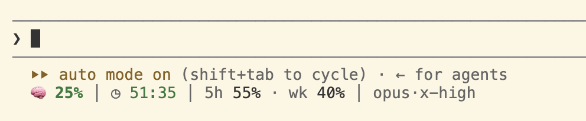

# Brain Drain for Claude Code

How full Claude's context is, when its cache goes cold, and how much of your 5-hour and weekly
limits is left — right under the prompt in Claude Code.



Brain Drain is a Claude Code mod: a plugin that runs inside Claude Code and reads its figures
from Claude Code itself. It never calls a model, makes no network requests, and never changes
what you type. It adds two things to what Claude reads: the name and description of its skill,
`/brain-drain:levels`, which Claude Code lists like any installed skill, and a short note so Claude
knows how full its own context is. The note comes when the context passes set levels, and also at
a session's first prompt or tool call, after a compaction, when the 5-hour window starts again, when
the account changes, and every 30 minutes by default. It names the account the figures belong to:
the login's email, or a short label you chose (below). The first time Brain Drain starts
in an interactive session, it asks whether to turn that note on, and the default it offers is on,
at 20, 30, 35 and 50%; `/drain notify off` stops it at any time. To check
this yourself before installing, clone the repository and run `claude plugin validate ./brain-drain`:
its `hooks:` and `calls:` lines list everything the mod asks Claude Code to do
([Mods overview](https://code.claude.com/docs/en/plugins/mods/overview)).

Not made by or affiliated with Anthropic.

## What it shows

- **Context:** how full the context window is, green, then yellow from 60%, red from 80%.
- **Cache countdown:** how long until the prompt cache expires, using the TTL Claude Code actually
  wrote (one hour or five minutes), read from the session transcript rather than guessed; if that
  cannot be read, the last lifetime seen on this account. Its colour is its own, never the
  context's: green, then for the one-hour cache yellow from 25 minutes left and red from 5, for the
  five-minute cache yellow under 60 seconds and red under 15, then `expired` in red (`exp` when the
  terminal is narrow).
- **Limits:** your 5-hour (`5h`) and weekly (`wk`) usage, yellow from 70%, red from 90%. When
  Claude Code reports a weekly figure but no 5-hour one, the line shows `5h –`: your plan reports
  no 5-hour limit right now. Both are hidden when Claude Code reports neither. The default style
  also shows when the 5-hour window resets, in your local time: `5h 55% ↻18:20`.
- **Model and effort**, for example `opus·medium`.

The context figure reads `–%` before the first reading, `~42%` after `/compact` until the next one,
and `⚠ 42%` when Claude Code reports a context window smaller than the tokens already in it.

Why the cache matters: Claude Code's documentation says that "after a long enough gap, the next
request recomputes the full input and re-establishes the cache, which is why the first turn back
after stepping away can be noticeably slower." It also says that once you go over your plan's
usage limit and draw on usage credits, "Claude Code drops the main conversation to the
five-minute TTL" ([How Claude Code uses prompt caching](https://code.claude.com/docs/en/prompt-caching)).
The countdown follows that switch.

## What it warns you about

- **A cold cache while you type.** If the cache has already expired, a red line appears under the
  gauge as soon as you start typing, before you send:
  `▲ cache expired · your next message re-writes ~312k tokens`
- **Expiry coming up.** A notice 60 seconds before the cache expires (`/drain warn` changes the
  lead time; `/drain sound on` adds a short chime).
- **What misses cost.** `/drain` lists the cache misses of today and the last 7 days, with the
  tokens re-written and the change in Claude Code's own session cost figure over the turn that
  opened cold. Misses are kept for 60 days.

## Telling Claude its own levels

Brain Drain adds a short note to Claude's own context, so the session knows where it stands
instead of guessing: one line of facts, and when the context passes a level, a line on what to do.
The facts name the account the usage figures belong to and the time they were read. The note says
it comes from the mod, so Claude does not take it for something you typed.

```
Brain Drain, you@example.com, read 20:14: context 36% (362k of 1M) · 5-hour window 82% used, resets 22:00 (in 1 h 46 min) · week 40% used, resets Sun 22 Nov 08:00 (in 5 d 11 h; pace line 27%). An automatic note from the Brain Drain mod, not typed by the user.
Set ahead of time for this level: Consider closing: finish the piece in hand and close the session, unless it clearly makes sense to go on.
```

Each reset gives its local clock time and how long until it. The weekday and date come only when
the reset is not today, so a 5-hour reset just after midnight reads `resets Tue 17 Nov 00:00 (in 19 min)`.
Once a window's reset time has passed, the line gives no figure for it until Claude Code reports
the new window: `5-hour window reset at 18:20, no new figure yet`.

The account is the email of the session's login, or `account` and the first 8 characters of its
id when only that is known. It reads `account not certain` when Brain Drain found no login record,
or when the login changed while the session ran; the figures are still the session's own.

- **A short name for the account (optional).** If `~/.claude/fuel-gauge-mod/labels.json` exists,
  the note uses the name it gives the session's account instead of the email, for example
  `{"<account uuid>": "work@"}`. The file is local and optional: Brain Drain only reads it, at most
  once a minute, from that place under your home folder whatever `CLAUDE_CONFIG_DIR` says. Without
  it, as on a plain install, the note shows the email. A name is used only for the account whose id
  matches, never when the account is not certain, and only in the note: the session files keep the
  email. A file that is not a map of names, or a name that is empty or longer than 64 characters, is
  ignored.

- **Setting it up.** The first time Brain Drain starts in an interactive session, it asks, in Claude
  Code's own question dialog, whether to turn the note on. The default it offers is on, at 20, 30,
  35 and 50%. You can pick it, pick Off, or type other levels (`25 40 60`). It asks once; if the
  question is dismissed, the offered default stands and a notice says so. If you changed any notice setting in an
  earlier version, it does not ask, and your settings stay as they were; turning the note on and off
  again cannot be told apart from never touching it, so then it asks.
- **What each level says by default.** At 20%: for information, carry on. At 30%: wind
  down; finish the piece in hand, commit it, and start nothing new. At 35%: consider
  closing; finish the piece in hand and close, unless it clearly makes sense to go on. At 50%: close
  now; finish the piece in hand, commit it, write a summary of where things stand, and end the
  session. Your own words replace these: `/drain notify text context 35 "your words"`. The same
  command with no words silences that level's words, and the line of facts still comes.
- It speaks once per level, after a tool call or when you send a prompt, and again only after
  the figure has dropped back below it. After a compaction, the first figure is told again. Where
  several levels pass at once, the note carries the highest one's words. It speaks to the main
  conversation only, never to subagents.
- The line of facts also comes on its own, with no words after it: at a session's first prompt or
  tool call (a new session, a `/clear`, a resume, a `claude -p` run), after a compaction even below
  every level, when the 5-hour window has started again and its new reset is known, when the
  account changes, and 30 minutes after the last note. `/drain notify refresh 60` changes the
  interval; `/drain notify refresh off` stops the timed note and leaves the others.
- The 5-hour and weekly figures ride along in the line. Thresholds of their own are off unless you
  set them: `/drain notify 5h 80 95` for the 5-hour window, `/drain notify week on` for weekly use
  going above the pace line (the share of the week gone since your weekly reset, plus 5 points).
- A skill, `/brain-drain:levels`, tells Claude how to read these figures itself; it loads on its own
  before a large piece of work or when Claude is asked how full its context is.
- Other context levels: `/drain notify context 30 50`. `/drain notify off` turns the note off;
  `/drain notify` shows what is set.
- It works in non-interactive `claude -p` runs too, with your saved
  settings, or the default if you never chose; such a run cannot ask. Nor, when we last tested it,
  can a session in Claude Code's VS Code chat panel, which runs as non-interactive. No figure can
  arrive before Claude Code's first response, because the figures do not exist until then: a note
  given before it names the account and says `no figures yet`, and the figures follow with the next
  note.

For unattended runs, the environment variable `BRAIN_DRAIN_NOTIFY` overrides your saved settings
for one run. It takes `on`, `off`, or JSON with any of these keys: `on`, `context` (a list),
`5h` (a list), `week` (true or false), `margin`, `refresh` (minutes, 0 for off), and `text` (keys `"context:35"`, `"5h:80"`,
`"week"`; words given for one level leave the other levels' words as they are). Any JSON value
turns the notice on for that run unless it includes `"on": false`. A run with
`BRAIN_DRAIN_NOTIFY` set is not asked the setup question. For example:

```
BRAIN_DRAIN_NOTIFY='{"context":[30,35],"5h":[80],"text":{"context:35":"stop and write down your state"}}' claude -p "..."
```

## Install

Requires Claude Code v2.1.287 or later (the first version with mods). Tested with v2.1.327 on
macOS, and with v2.1.301 on Linux (Ubuntu 24.04, arm64, in a dev container). Windows untested.

```
claude plugin marketplace add makingaipractical/brain-drain-for-claude-code
claude plugin install brain-drain@brain-drain
```

On Claude Code v2.1.292 or later, one command does both:
`claude plugin install brain-drain --marketplace makingaipractical/brain-drain-for-claude-code`.

Then run `/reload-plugins` in an open session, or start a new one.

The gauge draws in `claude` in any terminal, including VS Code's integrated terminal. In the Code
tab of the Claude Desktop app, and in Anthropic's VS Code chat panel (extension 2.1.299 or later,
per the [Mods overview](https://code.claude.com/docs/en/plugins/mods/overview), "Where mods run"),
it draws above the prompt box, whatever `/drain place` says: both show a mod's band above the prompt
but not the line under it (checked with Claude Code 2.1.321 in the Desktop app and VS Code extension
2.1.323). The `line` style uses the status line there too, and `/drain off` removes the gauge. A
session in either writes its session file, though both start their sessions as non-interactive.

The [Brain Drain VS Code extension](https://marketplace.visualstudio.com/items?itemName=makingaipractical.claude-code-fuel-gauge)
gets nothing from the panel through its status-line bridge, because the panel does not run Claude
Code's status line (checked on Claude Code 2.1.296). The mod writes a panel session's figures
itself, but the extension has not yet been tried with them.

To update: `claude plugin update brain-drain@brain-drain`, or turn on auto-update for the
marketplace in `/plugin` → Marketplaces.

**Nothing under the prompt?** Run `/plugin`: the line under the tabs should read
`1 mod active · brain-drain`. Check that `claude --version` is 2.1.287 or later. Mods are switched
off by `disableAllHooks` in your settings, by an organisation's `allowManagedModsOnly` or
`allowManagedHooksOnly` ([settings reference](https://code.claude.com/docs/en/settings-reference#what-runs-under-allowmanagedhooksonly)),
and for one session by `--safe-mode`. `/drain` shows what the mod sees. Mods are new, and a Claude Code update
can break one; if Brain Drain stops drawing,
[please open an issue](https://github.com/makingaipractical/brain-drain-for-claude-code/issues)
with your Claude Code version.

## Commands

| Command | What it does |
|---|---|
| `/drain` | The cache-miss report, the TTL and where it came from, and your settings |
| `/drain styles` | Previews every display style with your current figures |
| `/drain <style>` | Switches style (below) |
| `/drain place below\|above` | Draws under the prompt (default) or in the band above it |
| `/drain warn <seconds>` | Lead time of the expiry notice (default 60; 0 turns it off) |
| `/drain sound on\|off` | A short chime with the expiry notice (off by default) |
| `/drain notify ...` | The notice to Claude, above; `/drain notify` shows its settings, `/drain notify refresh <min>\|off` its timed refresh |
| `/drain agents on\|off` | A row under the gauge for each subagent Claude Code's agent panel does not list (finished and workflow agents), with its context and output; the panel's running agents by name and size on the total line; and Claude Code processes the session started from a Bash call, each announced by its own copy of the mod in `~/.claude/fuel-gauge/children/` (a launcher that clears the environment names the parent in `BRAIN_DRAIN_PARENT`). One whose transcript cannot be found reads `no transcript` after two minutes (on by default) |
| `/drain help` | The full list |

Styles:

- `minimal` (default): the figures as numbers, as in the example at the top.
- `bars`: a small bar beside each figure.
- `gauge`: a fuel needle for the context left, from E to F.
- `compact`: the shortest form.
- `line`: one plain line without colour, set as Claude Code's status text instead of drawn under
  the prompt.
- `off`: draws nothing; the session file is still written.

## With the VS Code extension

The two work side by side. The extension's status line bridge writes `~/.claude/fuel-gauge/`,
and while it is connected the mod writes its own copy to `~/.claude/fuel-gauge-mod/` instead, so
neither overwrites the other. If the bridge is not your status line, the mod writes
`~/.claude/fuel-gauge/` itself. A `claude -p` run writes its file to
`~/.claude/fuel-gauge-mod/headless/` once its first figures are in, and never to either folder
above, so the extension never draws one. From extension
v0.9.3, while the mod has written a session file in the last 36 hours, the extension does not ask
for Claude Code's status line, so you can keep your own.

## What it touches

- Reads: Claude Code's own figures and settings (to see whether the VS Code extension's bridge is
  connected), the end of the current session's transcript (for the exact cache TTL; with agent
  rows on, the default, also the subagent transcripts beside it), `account_ttl.json`,
  `~/.claude/fuel-gauge-mod/labels.json` if you made one (above), and which account the session
  runs on: the `CLAUDE_CODE_ACCOUNT_UUID` and `CLAUDE_CODE_USER_EMAIL` variables a host such as
  the Desktop app sets, else the account named in the configuration folder's `.claude.json` (its
  identity only; the login itself is never read).
- With agent rows on, it also reads the records in `~/.claude/fuel-gauge/children/` that name the
  current session, the transcripts of the sessions they announce, and, for a record that gives a
  process id, Claude Code's own record of that process, `~/.claude/sessions/<pid>.json` (never the
  `.key` file beside it).
- In a session another session started, and for each new record a parent reads, it lists the
  names in each folder from the session's root and working folder upward (your home folder and
  the folders above it left out) to look for a `.legal` marker. It opens no file there. A folder on a drive under
  `/Volumes` (macOS) counts as marked and is not listed.
- Writes: one file per session and `account_ttl.json`, in the folder described above, plus its
  own saved data in Claude Code's plugin storage. Each session file names the account its 5-hour
  and weekly figures belong to (`account_uuid`, `account_email`), or `null` where that is not
  certain, as after a `/login` to another account on the same folder (`account_source: changed`).
- A session that another session started (it inherited `CLAUDE_CODE_SESSION_ID`, or a launcher set
  `BRAIN_DRAIN_PARENT`) also writes one record, `~/.claude/fuel-gauge/children/<session>.json`,
  once at its start. The record holds both session ids, its process id, its start time, its root
  and working folder, and whether it is interactive. It is written whatever the agents setting, in
  `claude -p` runs too, and also while the bridge is connected. It is never written for a folder
  under a `.legal` marker, on a drive under `/Volumes` (macOS), or not cleared by your legal check.
- Removes: its own session files older than 36 hours from `~/.claude/fuel-gauge-mod/`, those of
  `claude -p` runs older than 6 hours from its `headless/` folder, records in
  `~/.claude/fuel-gauge/children/` older than 36 hours (at every session start, whatever the agents
  setting), and leftover temp files.
- Runs `tail`, `mv` and `rm` on those files only, `mkdir` for its folders, `sh -c 'echo $PPID'`
  once in a session another session started (to name its process for that session's agent row),
  a check program at `~/.claude/fuel-gauge/legal-check` only if you placed one there, and plays a
  bundled chime if you turn sound on. Nothing else.

To remove it: `claude plugin uninstall brain-drain@brain-drain`. Uninstalling leaves the session
files in `~/.claude/fuel-gauge-mod/` and the records in `~/.claude/fuel-gauge/children/`; delete
those folders if you want them gone.

## Contact

Questions go in [Discussions](https://github.com/makingaipractical/brain-drain-for-claude-code/discussions); bugs and ideas go in
[the issues](https://github.com/makingaipractical/brain-drain-for-claude-code/issues). What changed in each version is in [CHANGELOG.md](CHANGELOG.md).
If you would rather not use GitHub, or want to talk about something that does not belong on a
public tracker, email [info@makingaipractical.com](mailto:info@makingaipractical.com). A security
problem is best reported privately: [SECURITY.md](SECURITY.md) says how.

## Licence

MIT
